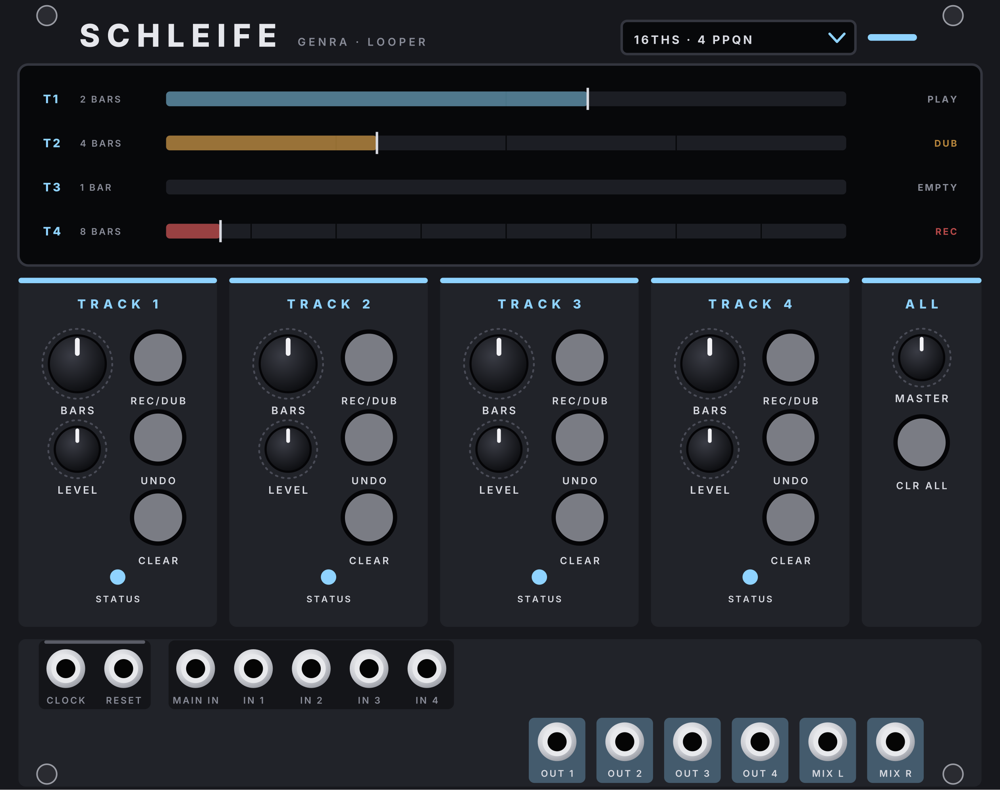

# GENRA Test

Testplugin für neue Instrumente der GENRA-Familie, bevor sie in **GENRA Instruments** einziehen. Es erscheint in
Rack unter der Marke **Genra**, neben GENRA und GENRA Instruments, und funktioniert mit beiden zusammen (Follow GENRA,
MIX ohne Kabel).

## SCHLEIFE (seit 2.9.0, Test)

Looper mit vier Spuren im GENRA-Look (32 HP, nach der Boss RC-505), im Takt mit GENRA.

- **Verkabeln:** GENRA CLOCK → CLOCK, GENRA RESET → RESET (Auflösung im Feld oben wie GENRAs CLOCK-Ausgang, Standard
  16tel). Mikrofon (z. B. aus WING-LINK) in **MAIN IN**; eine Spur mit eigenem Kabel in **IN 1–4** nimmt nur von dort
  auf, sonst von MAIN IN.
- **BARS** pro Spur: Länge der nächsten Aufnahme (1, 2, 4, 8, 16 Takte). **LEVEL** pro Spur, **MASTER** für MIX L/R.
- **REC/DUB** (ein Knopf wie bei der Boss): leere Spur → wartet auf den nächsten Takt (WAIT), nimmt BARS Takte auf
  (REC) und spielt dann (PLAY). Während sie spielt: Overdub sofort an (DUB), nochmal drücken: aus. Drücken während der
  Aufnahme: danach gleich Overdub. Ohne Kabel in CLOCK: frei, drücken startet, nochmal drücken beendet die Schleife.
- **UNDO** nimmt den letzten Overdub (oder ein CLEAR) zurück, nochmal UNDO bringt ihn wieder. Während WAIT/REC bricht
  UNDO die Aufnahme ab. **CLEAR** leert die Spur, **CLR ALL** (zweimal drücken, innerhalb von 2 s) alle vier.
- **Lämpchen:** rot Aufnahme (blinkt: wartet auf den Takt), orange Overdub, grün spielt, aus leer. Im Display pro Spur
  ein Balken mit Taktstrichen und der Position.
- **Im Takt bleiben:** jede Schleife springt auf ihrem eigenen Taktanfang an den Start. GENRAs RESET am Anfang jeder
  GENRA-Schleife ändert nichts, solange alles läuft; nach STOP und RUN (oder RUN mitten im Takt) starten alle
  Schleifen von vorn. Hält GENRA an, sind die Schleifen still und warten.
- **Ausgänge:** OUT 1–4 die Spuren nach LEVEL, MIX L/R die Summe (MIX nimmt sie auch ohne Kabel). Kein Mithören des
  Eingangs, kein Mute (macht der Mixer), keine Effekte (Modul dahinter).
- **Speichern:** die Schleifen werden mit dem Patch gespeichert (WAV im Patch, bis 48 s pro Spur).
  **Rechtsklick › Export (WAV):** eine Spur, alle Spuren in einen Ordner oder der Mix.
- **MPD218:** fertige Belegung in **GENRA MAP-X** 2.1.0 auf Bank B (siehe `mapx/README.md`).

## Weitere Plugins in diesem Repo

**Frühere Module:** MATH, KURBEL, SWARM, LIED, CANTA, MIAOU, SAURUS, FUMI und KESSEL mit KESSEL FX sind
getestet und mit GENRA 2.38.0 nach **GENRA Instruments** umgezogen (Repo
[Camillowup/Genra-for-Vcv](https://github.com/Camillowup/Genra-for-Vcv), Ordner `instruments/`). Patches mit diesen
Modulen aus GENRA Test: die Module einmal aus GENRA Instruments neu einsetzen. Das alte GENRA-Test-Plugin kann aus dem
Rack-Plugin-Ordner gelöscht werden, sonst stehen die Module doppelt im Browser.

Offenes und Geplantes: `docs/MERKLISTE.md`.

**GENRA NEON** (eigenes Plugin im Ordner `genra-neon/`, seit 19. Nov. 2026): die Neon-Module im NEON-TERRAIN-Look,
zuerst **WELLE** (Wavetable-Synth) und **NEBEL** (Cluster-Universum). Beschreibung: `genra-neon/README.md`.

**GENRA CHOP** (Hip-Hop-Beat-Generator mit Sample-Chopping) ist ein eigenes Plugin im eigenen Repo:
https://github.com/Camillowup/Genra-Chop

## Aufbau

| Ordner | Inhalt |
| --- | --- |
| `src/` | das Plugin (`plugin.cpp`, `plugin.hpp`, `shared.cpp`); ein neues Modul bekommt einen eigenen Ordner `src/<modul>/` (SCHLEIFE: `src/schleife/`) |
| `genra/`, `res/knob/` | **nicht im Repo:** die gemeinsamen Teile (Knöpfe, Follow GENRA, Link-Hub, JIANT-UI) kommen vor jedem Build frisch aus dem GENRA-Repo (`src/` und `res/knob/` von Camillowup/Genra-for-Vcv, Branch main); von Hand: `make genra-src` |
| `tools/gpanel.py`, `tools/jpanel.py`, `tools/panellib.py` | Werkzeuge für Panels im Look der Vorlagen (GENRA MONO, GRUND, FUNKE, SCHMELZ); ein Modul beschreibt seine Sektionen in `tools/<modul>_panel.py` (SCHLEIFE: `tools/schleife_panel.py real` schreibt `res/Schleife.svg` und `src/schleife/SchleifeLayout.hpp`, `preview docs/panels/schleife.png` die Vorschau) |

Gebaut wird über GitHub Actions (Windows bei jedem Push, Mac nur beim Release oder von Hand über Actions › Run
workflow). Ein Push auf den Branch `release` veröffentlicht den Release (nur auf ausdrücklichen Wunsch). **Regel:**
Wandert ein Modul nach GENRA Instruments, kommt es im selben Schritt hier heraus (sonst steht es in Rack doppelt).

## Lizenz

GPL-3.0-only (`LICENSE`). Fremdteile: zurzeit keine (siehe `licenses/README.md`).
