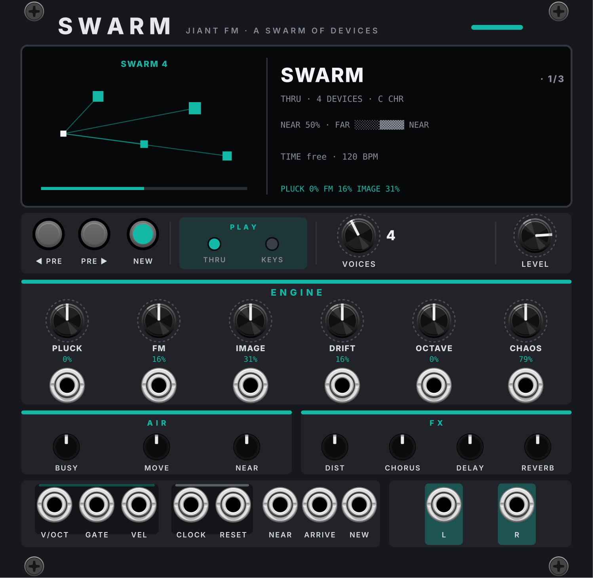
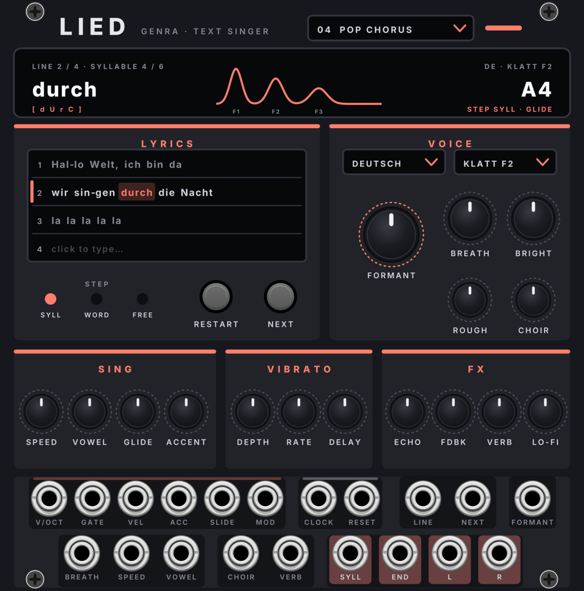
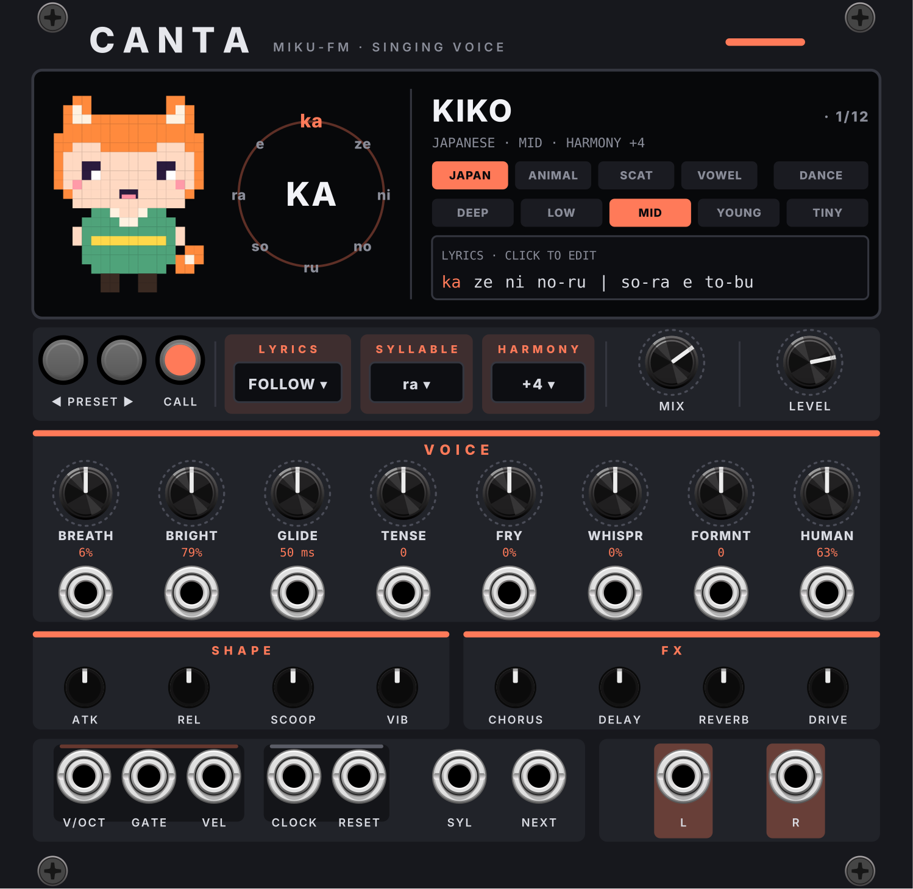
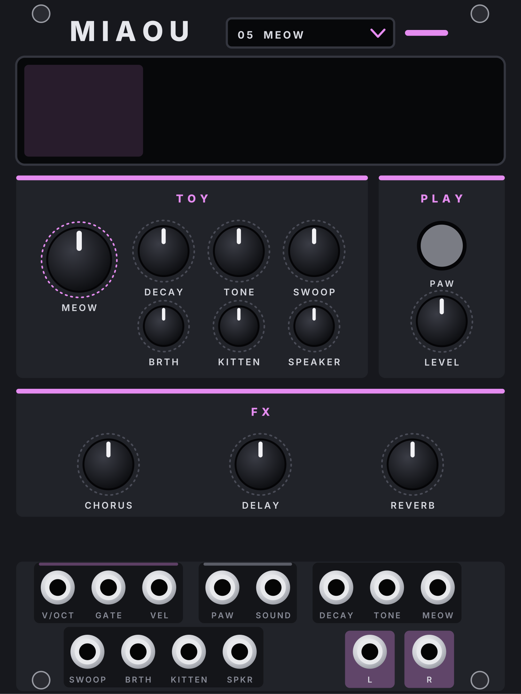
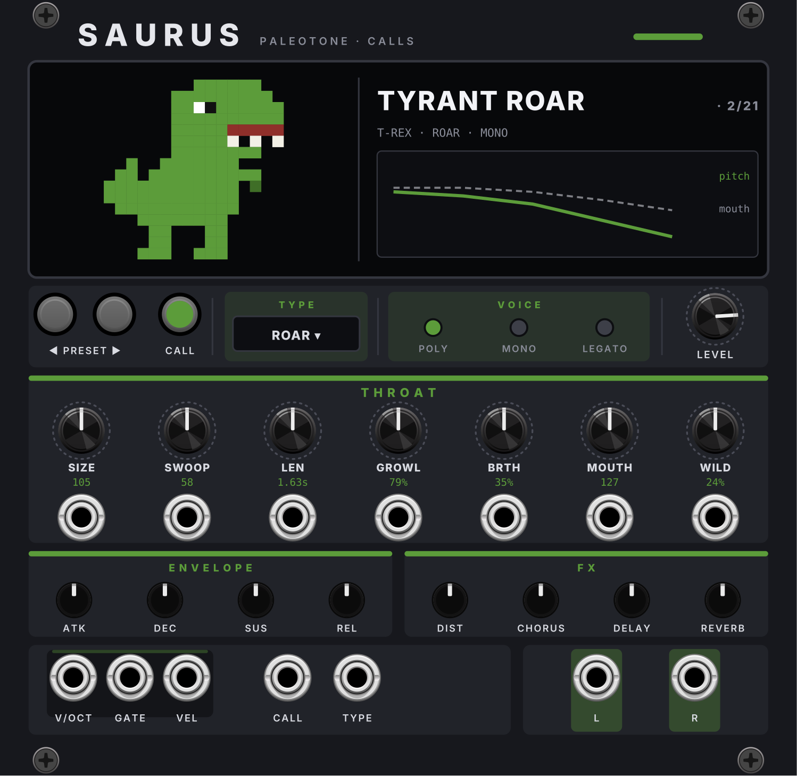

# GENRA Test

Testplugin für neue Instrumente der GENRA-Familie, bevor sie in **GENRA Instruments** einziehen. Es erscheint in
Rack unter der Marke **Genra**, neben GENRA und GENRA Instruments, und funktioniert mit beiden zusammen (Follow GENRA,
MIX ohne Kabel).

Zurzeit drin: **MATH**, **KURBEL**, **SWARM**, **LIED**, **CANTA**, **MIAOU** und **SAURUS**.

## Installieren

1. Unter **Releases** die Datei für dein System herunterladen: `win-x64` = Windows, `mac-arm64` = Mac mit Apple-Chip,
   `mac-x64` = Intel-Mac (Mac noch ungetestet). Neuere Testbuilds: unter **Actions** den letzten erfolgreichen Lauf
   öffnen, Artefakt **genra-test-windows** bzw. **genra-test-mac-…**.
2. Die `.vcvplugin`-Datei in den Plugin-Ordner im Rack-Benutzerordner legen (Rack › Help › Open user folder) und Rack
   neu starten.

## MATH

Die MATH-Engine aus der FM-1-Firmware **JIANT FM** von Juan Jiant: Bytebeat und Floatbeat. Die Musik steckt in einer
Formel der Zeit; daraus entstehen Klänge, Rhythmen und Melodien.

**Display:** links das Wesen der Engine (die Zeichnung der Firmware), rechts Preset, Einstellungen, Tempo und die
ersten Reglerwerte. Die Chips wählen **BYTE / FLOAT** und **CHIP** (4BIT, 4B/2, 8BIT bzw. FULL, 1BIT).

**Kopf:**
- **◀ PRE / PRE ▶**: Werks-Presets (12). Auch per Rechtsklick › Preset.
- **CALL**: bei KEYS spielt C4, bei THRU startet die Formel von vorn.
- **PLAY**:
  - **KEYS**: gespielt wie ein normales Instrument. V/OCT ist die Tonhöhe, GATE an = Ton, mit der Hüllkurve.
  - **THRU**: die Formel läuft von selbst durch, ohne Gate, wie ein Oszillator bzw. Loop. V/OCT verschiebt die
    Tonhöhe, ohne die Formel neu zu starten. Der Sustain steht dabei immer auf voll.
- **VOICE**: POLY, MONO, LEGATO.
- **LEVEL**.

**ENGINE** (je mit CV-Eingang, ±5 V = ± halber Bereich):
- **ALGO**: welche Formel (B01 … bei BYTE, F01 … bei FLOAT).
- **VAR**: verändert die Formel.
- **MOTION**: wie schnell sich die langsamen Teile (Rhythmus, Melodie) entwickeln. Ab der Hälfte **SYNC**: Rhythmus
  und Melodie laufen im Takt von CLOCK mit, die Note ändert nur noch die Tonhöhe.
- **GRIT** (bei FLOAT **FEEDBK**), **BEND**.
- **LOOP**: auf 0 entwickelt sich die Formel frei; hoch wird sie zu einem kurzen, gleichbleibenden Ton gefaltet.

**ENVELOPE** und **FX** wie bei VOICE und ANIMAL.

**Buchsen unten:** V/OCT · GATE · VEL (GENRA-Leiste), **CLOCK · RESET**, L/R.
- **CLOCK**: Tempo und Takt für MOTION SYNC. Standard sind 16tel wie GENRAs Clock-Ausgang; per Rechtsklick ›
  Clock input auch 8tel, Viertel oder 24 PPQN. Ohne Clock läuft die Zeit im letzten Tempo weiter (anfangs 120 BPM).
- **RESET**: setzt die Song-Position auf Anfang; bei THRU startet auch die Formel neu.
- **Ohne Kabel:** Rechtsklick › Follow GENRA. Dann kommen Noten, Clock und Reset direkt von GENRA.

## KURBEL

Die Drehleier aus der FM-1-Firmware **ESTAMPIE** (die GURDY-Engine von GHOULBOX) und dazu die Schalmei. Eine
Melodiesaite, zwei Bordun-Saiten (Grundton und Quinte), die schnarrende Trompette und ein Holzkörper.

**Display:** links das Rad mit den Saiten. Das Rad dreht sich mit der Kurbel (bei COUP CRANK) bzw. gleichmässig,
solange ein Ton klingt; die Melodiesaite leuchtet, die Trompette blitzt bei jedem Stoss. Rechts Preset, Einstellungen,
Tempo bzw. Kurbel. Die Chips wählen **WHEEL / REED** (Drehleier / Schalmei) und die Stimmung **EQUAL, PYTH, MEAN,
JUST** (gleichstufig, pythagoreisch, mitteltönig, rein; gezählt ab dem Bordun).

**Kopf:**
- **◀ PRE / PRE ▶ · CALL**: 8 Werks-Klänge (Hurdy Gurdy, Drone Wheel, Dance Gurdy, Trompette, Vielle, Bagpipe, Trotto Gurdy,
  Shawm). Auch per Rechtsklick › Preset.
- **RING** (Taster mit Licht): die Bordun-Saiten klingen durch die Pausen weiter, wie bei einer echten Drehleier.
- **DRONE**: Tonart der Bordun-Saiten (C bis B), zugleich Grundton der Stimmung.
- **COUP**: die Handgelenk-Stösse, die das Schnarren anstossen: HOLD (immer), 1/4, 1/8, 1/8T, 1/16 im Tempo von
  CLOCK, oder **CRANK**.
- **CRANK**: wie schnell gekurbelt wird (Umdrehungen pro Minute, daneben angezeigt). Gilt bei COUP CRANK: die
  Geschwindigkeit ist der Bogendruck (Lautstärke, Helligkeit); still = stumm. Ein schneller Ruck nach oben ist ein
  Stoss (das Schnarren setzt kräftig ein).
- **LEVEL**.

**ENGINE** (je mit CV): bei WHEEL **DLVL** (Bordun), **5TH** (Quinte), **WHL** (Raddruck; bei CRANK: wie schnell
für vollen Druck), **BUZZ** (Schnarren), **BODY**, **WOBL** (Unruhe des Rads). Bei REED wechseln Namen und Funktion
(INT2, INT3, DTN, CUT, RES, PW der Schalmei); die Anzeige wechselt mit.

**Buchsen unten:** V/OCT · GATE · VEL (GENRA-Leiste; eine Melodiesaite: ein neuer Ton bei gehaltenem Gate gleitet),
**CLOCK · RESET** (Tempo der Stösse; RESET startet die Stösse eines gehaltenen Tons neu), **CRANK** (CV, zum Regler
addiert: 1 V = 24 rpm), **BUZZ** (Trigger: ein Stoss, bei COUP CRANK), L/R. Ohne Kabel: Rechtsklick › Follow GENRA.

**Kurbeln ohne Gate** (ab 2.2.1 Standard aus): Rechtsklick › *Crank plays without a gate* einschalten. Dann spielt
KURBEL bei COUP CRANK ohne Gate von selbst, solange gekurbelt wird: Bordune und Melodiesaite auf dem DRONE-Ton (C3 …),
mit V/OCT auf dessen Ton. Ein Gate spielt wie gewohnt die Note von V/OCT. Die Einstellung wird im Patch gespeichert.

**CALL** (ab 2.2.1): spielt die Melodiesaite, solange gedrückt (auf V/OCT, ohne Kabel D4), zum schnellen Anspielen.

**Kurbel-Tempo** (ab 2.2.1): 90 rpm (der Standard) geben bei jeder WHL-Einstellung vollen Bogendruck, darunter wird
es leiser bis still; vorher brauchte es je nach WHL deutlich mehr.

## SWARM

Der Schwarm aus der JIANT-Firmware: Jedes Gerät in der Nähe ist eine Stimme. Hier ohne echtes Bluetooth: die Geräte
sind **virtuell** und schicken der unveränderten Engine erfundene Funkpakete. Ihre Adresse ist der Ton, der
Hersteller die Klangfamilie (Glas/Glocken, Rohrblatt, Holz), die Datenbytes der FM-Modulator, der Sendeabstand der
Rhythmus (die Schwankung ein Vibrato), die Signalstärke die Nähe, der Funkkanal die Seite im Stereobild. Dazu spielt
eine Lead-Stimme eine Melodie im Tempo; sie folgt den Änderungen der Nähe.

**Display:** links der Schwarm, wie die Firmware ihn zeichnet (jedes Gerät ein Punkt, Linien zum lautesten, unten
FAR … NEAR). Rechts Preset, PLAY, Anzahl der Geräte, Tonart, die Nähe als Balken, Tempo.

**Kopf:** ◀ PRE / PRE ▶ (SWARM, SWARM PLUCK, SWARM CHOIR), **NEW** (ein neuer Schwarm: alle Geräte neu),
**PLAY** THRU (summt ständig) oder KEYS (spielbar: das Gate ist der Ton, seine Spannung die Lautstärke, kurze
Rampe gegen Klicks), **VOICES** (1–8 Geräte), **LEVEL**.

**ENGINE** (je mit CV): PLUCK, FM, IMAGE, DRIFT, OCTAVE, CHAOS. **AIR:** BUSY (wie oft sie senden), MOVE (sie laufen
herum, kommen und gehen), NEAR (wie nah sie sind). **FX:** DIST, CHORUS, DELAY, REVERB.

**Buchsen unten:** V/OCT (transponiert, C4 = Originallage) · GATE · VEL, CLOCK · RESET (das Raster der Lead-Stimme),
**NEAR** (CV, zum Regler addiert), **ARRIVE** (Trigger: ein neues Gerät kommt), **NEW** (Trigger: neuer Schwarm), L/R.
Rechtsklick: Follow GENRA, Clock-Eingang, Root und Scale der Geräte-Töne, Preset. Der Schwarm wird im Patch gespeichert.

## LIED

Ein Textsänger (25 HP): Du tippst bis zu vier Zeilen Liedtext direkt aufs Panel, **eSpeak NG** spricht sie, und LIED
singt sie Silbe für Silbe auf die Töne von V/OCT. Jedes Gate singt die nächste Silbe, der Vokal hält, solange das Gate
offen ist, beim Loslassen kommt der Rest der Silbe (z. B. das „cht“ von „Nacht“).

**Display:** links Zeile und Silbe, die gesungene Silbe gross und ihre Laute (eSpeaks Lautschrift), in der Mitte das
Spektrum ihres Vokals (die Formanten), rechts Sprache · Stimme, der Ton und STEP. „…“ heisst: eSpeak spricht gerade
eine geänderte Zeile.

**Kopf:** das **Preset-Feld** (16 Werks-Klänge, z. B. POP LEAD, SOUL DIVA, MONK CHANT, ANGEL CHOIR, ROBOT, WHISPER,
DUB ECHO, SPOKEN). Ein Preset stellt Stimme und Regler; Text, Sprache und STEP bleiben. Auch per Rechtsklick › Preset.

**LYRICS:**
- Vier Zeilen, direkt anklicken und tippen. Ein **Bindestrich** trennt Silben dort, wo du willst („sin-gen“); ohne
  Bindestrich teilt LIED nach eSpeaks Lauten (eine Silbe pro Vokal). Die Silbe, die gerade klingt, leuchtet.
- **Zeilennummer** anklicken = diese Zeile wird gesungen (der Balken links zeigt sie). Per **LINE**-CV auch von aussen
  (0–2,5 V Zeile 1, 2,5–5 V Zeile 2 …). Beim Zeilenwechsel geht es bei der ersten Silbe los.
- **STEP**: **SYLL** (jedes Gate eine Silbe), **WORD** (jedes Gate ein ganzes Wort, der letzte Vokal hält),
  **FREE** (ein Gate singt die ganze Zeile in einem Zug, V/OCT bleibt live).
- **RESTART**: zurück zur ersten Silbe (wie der RESET-Eingang). **NEXT**: eine Silbe überspringen (wie der
  NEXT-Eingang). Nach der letzten Silbe geht es wieder von vorn los.

**VOICE:**
- **Sprache**: Deutsch, English, English US, Français, Español, Italiano, Nederlands, Português, Svenska, Polski,
  Suomi, Latina. **Stimme**: KLATT 1–6, MALE 1/3/6, FEMALE 1/3/5, CROAK, WHISPER.
- **FORMANT** (mit CV): kleinerer / grösserer Sänger, ohne dass sich der Ton ändert. **BREATH** (mit CV): Hauch.
  **BRIGHT**: heller / dunkler. **ROUGH**: raue, unruhige Stimme. **CHOIR** (mit CV): drei weitere Sänger, leicht
  verstimmt und versetzt, links und rechts.

**SING:** **SPEED** (mit CV): wie schnell die Konsonanten kommen (0,5- bis 2-fach). **VOWEL** (mit CV): wie lange
der Vokal hält; ganz rechts so lange wie das Gate, ganz links wie gesprochen. **GLIDE**: Gleiten zum nächsten Ton.
**ACCENT**: wie stark ein ACC-Gate die Note anhebt (lauter, heller).

**VIBRATO:** DEPTH, RATE, DELAY (setzt nach der Verzögerung sanft ein). Der **MOD**-Eingang der GENRA-Leiste gibt
mehr Vibrato dazu (wie ein Modulationsrad).

**FX:** **ECHO** (punktierte Achtel im Tempo von CLOCK, Ping-Pong), **FDBK**, **VERB** (mit CV), **LO-FI**.

**Buchsen:** GENRA-Leiste V/OCT · GATE · VEL · ACC · SLIDE · MOD, dann CLOCK · RESET; LINE, NEXT, FORMANT, BREATH,
SPEED, VOWEL, CHOIR, VERB; Ausgänge **SYLL** (Trigger bei jeder gesungenen Silbe), **END** (Trigger bei der letzten
Silbe der Zeile), L/R (nur L gesteckt: Mono-Summe). **SLIDE**: ein Gate bei hohem SLIDE singt keine neue Silbe, der
Vokal gleitet zum neuen Ton weiter (Melisma). Ohne Kabel: Rechtsklick › Follow GENRA (z. B. GENRAs Melodiespur);
per Rechtsklick auch der Clock-Eingang (16tel wie GENRA, 8tel, Viertel, 24 PPQN).

**Wie es klingt:** eSpeak ist eine Formant-Sprachsynthese, keine Aufnahme eines Sängers; es klingt eher nach Roboter
oder Vocoder als nach einer echten Stimme. Am natürlichsten: eine KLATT- oder FEMALE-Stimme, etwas Vibrato, CHOIR
und Hall. Text und Einstellungen werden im Patch gespeichert.

## CANTA

Die Singstimme aus der FM-1-Firmware **MIKU-FM** (26 HP): eine Formant-Stimme, die japanische Silben (Morae) singt.
Nur die Stimme; die Band von MIKU-FM (Akkorde, Bass, Drums) und ihr Sequencer sind nicht dabei, das übernimmt GENRA.
Jedes Gate singt die nächste Silbe des Liedtexts, ein neuer Ton bei gehaltenem Gate gleitet.

**Display:** links die Sängerin der Sprache (eigene Pixel-Figuren, nichts aus MIKU-FM): **KIKO** (JAPAN),
**MOMO** (ANIMAL), **NANA** (SCAT), **SORA** (VOWEL). Sie öffnet den Mund je nach Vokal und blinzelt; mit **DANCE**
macht sie auf jeden Schlag einen Schritt (mit CLOCK im Takt, sonst bei jedem Gate). Daneben das Silben-Rad: oben und
gross in der Mitte die Silbe, die gerade klingt, rundherum die nächsten (bei ANIMAL und SCAT die letzten gebabbelten).
Rechts Preset, Sprache · Charakter · Harmonie, die Chips:
- **JAPAN** (der Text wie geschrieben), **ANIMAL** (Tierlaute-Gebabbel, solange das Gate offen ist, mit kleinen
  Tonsprüngen), **SCAT** (da ba bi do … in Achteln von CLOCK), **VOWEL** (nur die Vokale des Texts).
- **DEEP, LOW, MID, YOUNG, TINY**: die Grösse der Stimme (Formanten).
- Darunter die **Textzeile**: die Silbe, die als nächste bzw. gerade klingt, leuchtet. **Anklicken** öffnet den
  Editor (auch Rechtsklick › Edit the lyrics…), Enter übernimmt.

**Liedtext** (MIKU-FMs Schreibweise, in Romaji): Silben mit Bindestrich, Wörter mit Leerzeichen: `ka-ze ni no-ru`.
`_` hält den Vokal weiter (ohne Konsonant), `/` ist eine Pause, `|` das Ende einer Phrase (Pausen werden beim Singen
übersprungen), `!` nach einer Silbe setzt sie neu an. Gültig sind die 72 Silben von MIKU-FM (a i u e o, ka … n, ga …
po, sha, ja, rya); ein Fehler wird rot angezeigt, dann bleibt der alte Text. Nach der letzten Silbe geht es von vorn
los.

**Kopf:**
- **◀ PRE / PRE ▶**: 12 eigene Presets (KIKO, HANA, YUME, DUET, ROBO, SASAYAKI, MOMO, KUMA, NANA, BEBOP, SORA,
  CHOIR), jedes mit Sprache, Klang und Liedtext. LEVEL und LYRICS/SYLLABLE bleiben. Rechtsklick › *Presets keep the
  lyrics*: der eigene Text bleibt auch beim Presetwechsel.
- **CALL**: singt, solange gedrückt (auf V/OCT, ohne Kabel G4).
- **LYRICS**: **FOLLOW** (jedes Gate die nächste Silbe) oder **FIXED** (immer die SYLLABLE).
- **SYLLABLE**: die Silbe für FIXED (Liste aller 72).
- **HARMONY**: eine zweite Stimme im Intervall (OFF, −12, +3, +4, +5, +7, +12), mit eigenem Charakter und leicht
  verstimmt; **MIX** ihre Lautstärke. **LEVEL**.

**VOICE** (je mit CV, ±5 V = ± halber Bereich): **BREATH** (Hauch), **BRIGHT**, **GLIDE** (Gleiten zum neuen Ton,
0–500 ms), **TENSE** (weich ↔ gepresst, Mitte neutral), **FRY** (Knarren), **WHISPR** (Flüstern), **FORMNT** (feine
Verschiebung der Formanten, Mitte neutral), **HUMAN** (kleine Unruhe in Tonhöhe und Vibrato; 0 = maschinengenau).
**SHAPE:** ATK, REL, **SCOOP** (der Einsatz kommt von unten), **VIB** (Vibrato-Tiefe). **FX:** CHORUS, DELAY
(punktierte Achtel im Tempo), REVERB, DRIVE.

**Buchsen unten:** V/OCT · GATE · VEL (GENRA-Leiste), **CLOCK · RESET** (Tempo für SCAT, Delay und DANCE; RESET
springt an den Anfang des Texts), **SYL** (CV 0–10 V: bei FOLLOW wo im Text das nächste Gate singt, bei FIXED welche
Silbe), **NEXT** (Trigger: die nächste Silbe sofort, gebunden), L/R (nur L gesteckt: Mono). Ohne Kabel: Rechtsklick ›
Follow GENRA. Rechtsklick auch: Clock-Eingang (16tel wie GENRA, 8tel, Viertel, 24 PPQN) und *A new pitch under a held
gate sings the next syllable* (gebundene Silben bei Sequencern, die das Gate offen halten). Text und Einstellungen
werden im Patch gespeichert.

## MIAOU

Das Spielzeug-Keyboard aus der FM-1-Firmware **MIAOU** (26 HP): fünf Klänge, polyphon (bis 16 Stimmen über ein
Poly-Kabel). Nur die Klänge und der kleine Lautsprecher; Rhythmen, Kinderlieder, Recorder, Arpeggiator und Sequencer
von MIAOU sind nicht dabei, das übernimmt GENRA.

**Display:** links eine eigene Pixel-Katze (nichts aus MIAOU): die Augen folgen dem letzten Ton (tief links, hoch
rechts), sie blinzelt ab und zu, und beim Miauen geht das Maul auf. **Anklicken** = ein kurzes Miau. Rechts der Klang,
PAW an/aus, der letzte Ton, der Lautsprecher und 27 Tasten (C3–D5), die beim Spielen leuchten.

**Kopf:**
- **PAW**: alle Tasten miauen (rastet ein, leuchtet); nochmal drücken = zurück zum Klang.
- **SOUND**: **PIANO** (Chip-Klavier), **BELLS** (FM-Glocken), **ORGAN** (Rechteck-Orgel), **BANJO** (gezupfte Saite,
  Karplus-Strong), **MEOW** (eine Stimme durch drei wandernde Formanten: m-i-a-ou). Lämpchen anklicken. **LEVEL**.

**TOY** (je mit CV, ±5 V = ± halber Bereich): **DECAY** (Ausklang und Loslassen, 25–400 %), **TONE** (Helligkeit:
Filter von Klavier und Orgel, Glockenhelligkeit, Banjo-Anschlag), **MEOW** (Länge des Miaus, 0,2–1,55 s), **SWOOP**
(wie weit das Miau hoch- und runtergeht), **BRTH** (Hauch), **KITTEN** (Formanten in Halbtönen: höher = jüngere
Katze; +3 ist MIAOUs eigenes Kätzchen), **SPEAKER** (der Spielzeug-Lautsprecher: keine Bässe, weiche Höhen,
angezerrt, 8 Bit; 0 = sauber). Mitte bzw. Standard = wie in MIAOU. **FX:** CHORUS, DELAY (330 ms, Ping-Pong), REVERB
(Raum).

**Buchsen unten:** V/OCT · GATE · VEL (GENRA-Leiste, polyphon), **PAW** (Gate: miaut, solange es anliegt), **SOUND**
(CV, 2 V pro Klang, zum Schalter addiert), L/R (nur L gesteckt: Mono). Ohne Kabel: Rechtsklick › Follow GENRA.
## SAURUS

Die Kreaturenrufe aus der FM-1-Firmware **PALEOTONE** (die SAURUS-Engine, 26 HP): eine brummende Kehle durch drei
Formanten, von einem kleinen Vogel bis zum Sauropoden. Jeder Ton ist ein Ruf: Tonhöhe, Maul und Lautstärke folgen der
Form des Rufs über LEN.

**Display:** links eine von acht eigenen Pixel-Kreaturen (T-REX, RAPTOR, LONGNECK, CRESTED, PTEROSAUR, FRILLED,
TOAD, GIANT APE), je nach Preset; sie reisst das Maul auf, solange der Ruf laut ist. Beim KEYS-Kit zeigt sie die
Kreatur der zuletzt gespielten Taste. Rechts Preset, Kreatur · Ruf · Stimme und die Form des Rufs (Tonhöhe grün,
Maul gestrichelt), mit einem Strich, wo der Ruf gerade ist.

**Kopf:**
- **◀ PRESET ▶**: 21 Werks-Klänge (Brachio Call, Tyrant Roar, Raptor Bark … Compy Pack, dazu CALL KIT). Auch per
  Rechtsklick › Preset.
- **CALL** (Taster mit Licht): ein Ruf, solange gedrückt (auf V/OCT, ohne Kabel C3; beim Kit die Kreaturen der
  Reihe nach).
- **TYPE**: die Form des Rufs: HOLD (wie gespielt), BELLOW, ROAR, BARK, HOOT, TRILL, CHIRP, MOAN, HISS, SNORT,
  **KEYS** (das Kit: ab C2 jede Taste eine der 20 Kreaturen, mit ihren eigenen Einstellungen; die Regler verschieben
  sie alle, Mitte = wie sie ist).
- **VOICE**: POLY, MONO, LEGATO. **LEVEL**.

**THROAT** (je mit CV, ±5 V = ± halber Bereich): **SIZE** (Grösse des Tiers: tiefe Kehle), **SWOOP** (wie weit die
Tonhöhe im Ruf wandert), **LEN** (Länge des Rufs), **GROWL** (Knurren, Rauheit), **BRTH** (Atem), **MOUTH** (wie
weit das Maul aufgeht), **WILD** (jeder Ruf etwas anders). **ENVELOPE** ATK DEC SUS REL, **FX** DIST, CHORUS,
DELAY, REVERB.

**Buchsen unten:** V/OCT · GATE · VEL (GENRA-Leiste, polyfon), **CALL** (Trigger: ein Ruf in der Länge von LEN),
**TYPE** (CV, zum Schalter addiert: 1 V je Rufform), L/R (nur L gesteckt: Mono). Ohne Kabel: Rechtsklick › Follow
GENRA; solange SAURUS einem GENRA folgt, läuft das Delay in dessen Tempo (sonst 120 BPM). Kein CLOCK/RESET.

## Aufbau

| Ordner | Inhalt |
| --- | --- |
| `src/` | das Plugin (MATH: `src/math/`, KURBEL: `src/kurbel/`, SWARM: `src/swarm/`, LIED: `src/lied/`, CANTA: `src/canta/`, MIAOU: `src/miaou/`, SAURUS: `src/saurus/`) |
| `genra/`, `res/knob/` | **nicht im Repo:** die gemeinsamen Teile (Knöpfe, Follow GENRA, Link-Hub, JIANT-UI) kommen vor jedem Build frisch aus dem GENRA-Repo (`src/` und `res/knob/` von Camillowup/Genra-for-Vcv, Branch main); von Hand: `make genra-src` |
| `mathcore/` | der MATH-Kern: die Firmware als kleine C-Bibliothek (`res/mathcore.dll`), eine private Kopie pro Modul |
| `jiant.tar.gz` | Schnappschuss der JIANT-FM-Quellen (Branch `codex/swarm`, V10.7.16; siehe `jiant/SNAPSHOT.txt`), beim Bauen entpackt |
| `kurbelcore/` | der KURBEL-Kern (`res/kurbelcore.dll`), ebenso |
| `swarmcore/` | der SWARM-Kern (`res/swarmcore.dll`, aus demselben JIANT-Schnappschuss), mit den virtuellen Geräten |
| `estampie.tar.gz` | Schnappschuss der ESTAMPIE-Quellen (Commit 6c4f0c7; siehe `estampie/SNAPSHOT.txt`), beim Bauen entpackt |
| `liedcore/` | der LIED-Kern (`res/liedcore.dll`): eSpeak NG als kleine C-Bibliothek, einmal pro Rack geladen |
| `espeak.tar.gz` | Schnappschuss der eSpeak-NG-1.52.0-Quellen (siehe `espeak/SNAPSHOT.txt`), beim Bauen entpackt; die übersetzten Sprachdaten liegen in `res/espeak-ng-data` |
| `cantacore/` | der CANTA-Kern (`res/cantacore.dll`): MIKU-FMs Stimme mit Sprachen, Harmonie und Presets, eine private Kopie pro Modul |
| `canta.tar.gz` | Schnappschuss nur des Stimmen-Codes von MIKU-FM (Commit 781760c; siehe `canta/SNAPSHOT.txt`), beim Bauen entpackt; keine Grafiken |
| `miaoucore/` | der MIAOU-Kern: MIAOUs Klänge (`toy.c`) mit ihren Stimmen in einer Struktur, direkt ins Plugin gebaut (keine eigene Bibliothek nötig) |
| `tools/*_panel.py` | erzeugen `res/<Modul>.svg` und `src/<modul>/<Modul>Layout.hpp` (gemeinsame Teile: `tools/jpanel.py`); `preview` macht ein PNG |
| `test/*core_test.c` | Tests der Kerne ohne Rack (MATH: Presets, KEYS, THRU, SYNC; KURBEL: Presets, Kurbel, Stoss; SWARM: Presets, Luft, ARRIVE, NEW, Zeichnung; LIED: alle Sprachen und Stimmen, Tonhöhe; CANTA: Presets, Liedtext, FIXED, ANIMAL, Harmonie; MIAOU: alle Klänge, Regler an den Enden, Miau-Länge, 16 Stimmen, Fuzz) |
| `sauruscore/` | der SAURUS-Kern (`res/sauruscore.dll`): PALEOTONEs Firmware mit der SAURUS-Engine, eine private Kopie pro Modul |
| `paleotone.tar.gz` | Schnappschuss der PALEOTONE-Quellen, nur was der Host-Build braucht (siehe `paleotone/SNAPSHOT.txt`), beim Bauen entpackt |
| `tools/*_panel.py` | erzeugen `res/<Modul>.svg` und `src/<modul>/<Modul>Layout.hpp` (gemeinsame Teile: `tools/jpanel.py`); `preview` macht ein PNG |
| `test/*core_test.c` | Tests der Kerne ohne Rack (MATH: Presets, KEYS, THRU, SYNC; KURBEL: Presets, Kurbel, Stoss; SWARM: Presets, Luft, ARRIVE, NEW, Zeichnung; LIED: alle Sprachen und Stimmen, Tonhöhe; CANTA: Presets, Liedtext, FIXED, ANIMAL, Harmonie; SAURUS: alle 21 Presets, Rufformen) |
| `docs/panels/` | Panel-Bilder der Module |
| `test/lied_test.cpp` | LIEDs Gesang ohne Rack: Silben bekannter Wörter, gesungene Tonhöhe = Note, gehaltener Vokal, CHOIR und FX |

Gebaut wird über GitHub Actions (Windows und Mac, bei jedem Push). Ein Push auf den Branch `release` veröffentlicht
den Release (nur auf ausdrücklichen Wunsch). Für später ist alles so angelegt, dass jedes Modul ohne Umbau nach
GENRA Instruments wandern kann (eigener Ordner, eindeutige Namen, Follow über den Link-Hub). **Regel:** Wandert ein
Modul nach GENRA Instruments, kommt es im selben Schritt hier heraus (sonst steht es in Rack doppelt).

## Lizenz

GPL-3.0-only (`LICENSE`). SAURUS ist die Kreaturen-Engine aus PALEOTONE (github.com/fantasmoslam/Paleotone, auf SLOOP
und Felucca, GPL-3.0-only); die Pixel-Kreaturen sind eigene Grafiken. CANTA singt mit MIKU-FMs Stimme (github.com/MichaelAPerry/MIKU-FM1, Code GPL-3.0-only);
die Sängerinnen sind eigene Grafiken, von MIKU-FMs Grafik (Hatsune Miku, Piapro Character License) ist nichts übernommen. LIED spricht mit eSpeak NG (GPL-3.0-or-later). KURBEL ist die Drehleier aus ESTAMPIE (GHOULBOX' GURDY-Engine), die Schalmei Feluccas
TRIO-Engine (MIT). MATH ist die Engine aus JIANT FM von Juan Ignacio Antonucci (Juan Jiant), einem Fork von
Felucca (Leo Kuroshita, Hügelton Instruments), ebenfalls GPL-3.0-only. MIAOU spielt die Klänge aus MIAOU
(github.com/pjac1810/miaou, GPL-3.0-only); die Katze ist eine eigene Grafik. Fremdteile und ihre Lizenzen: `licenses/`.
