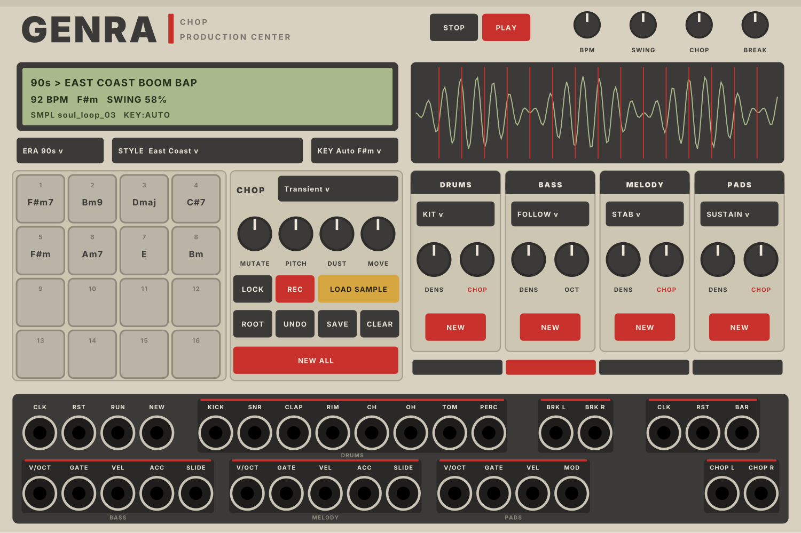

# GENRA CHOP

Ein Hip-Hop-Beat-Generator im Look einer alten Production Center (beiges Gehäuse, graue Pads, Akai-Rot, grünes LCD).
Eigenes Plugin (**GENRA CHOP**, Slug `GenraChop`; bis 2.1.0 hiess es GENRA HipHop) unter der Marke **Genra**, liegt
im Repo von GENRA Test im Unterordner `genra-chop/`. Drei Module in einer Datei: **GENRA CHOP** (38 HP),
**GENRA CHOP GRID** (der Grid-Editor, 44 HP) und ab 2.2.0 **GENRA CHOP ABLAUF** (der Song-Arranger, 26 HP).
Patches mit dem alten GENRA HipHop laden nicht mehr (neuer Slug).

## Installieren

Unter **Actions** den letzten erfolgreichen Lauf öffnen, Artefakt **genra-chop-windows** herunterladen (Mac:
**genra-chop-mac-…**, nur über Actions › Run workflow), die `.vcvplugin`-Datei in den Plugin-Ordner im
Rack-Benutzerordner legen (Rack › Help › Open user folder) und Rack neu starten.

## Bedienung

**Kopf:** STOP hält an und springt auf Takt 1 (zweimal STOP schneidet auch Chops und Break ab), PLAY startet bei
Takt 1 (ohne Kabel im RUN-Eingang). **BPM**, **SWING** (50 % gerade bis 75 %), **CHOP**
(Lautstärke der Chops) und **BREAK** (Lautstärke des Breaks).

**Display:** Jahrzehnt und Stil, Tempo, Tonart (ein `*` heisst: von Hand gesetzt), Swing, Takt; darunter das Sample
(Name, Anzahl Chops, ob die Tonart aus dem Sample kommt) oder der Stand der Analyse.

**ERA / STYLE / KEY:** anklicken = Liste, Mausrad = blättern. 29 Stile nach Jahrzehnt:
- **80s:** Electro Rap, Old School Boom Bap, Golden Age, Miami Bass, New Jack Swing
- **90s:** East Coast Boom Bap, Jazz Rap, Dark NY, G-Funk, West Coast Funk, Memphis, Dirty South
- **2000s:** Soul Chop, Dilla Wonky, Neptunes Timbaland, Crunk, Abstract, Snap
- **2010s:** Trap, Chicago Drill, UK Drill, Cloud Rap, Lo-Fi Hip-Hop, Ratchet, Grimy Revival
- **2020s:** Drumless, Rage, Plugg Pluggnb, Drift Phonk

Ein neuer Stil setzt BPM und Swing auf seine Werte und würfelt alles neu (mit UNDO zurück). **KEY Auto** nimmt die
Tonart aus dem Sample; eine Tonart von Hand würfelt Akkorde, Bass, Melodie und Pads neu.

**Pads (1–16):** jedes Pad ist ein Chop des Samples, mit dem erkannten Akkord (rot = von Hand gesetzt, HIT = ohne
Tonhöhe). **Klick** spielt das Pad. **Rechtsklick:** Lock (bleibt bei NEW und MUTATE stehen), Reverse, Pitch
(−12 bis +12) und Akkord (wie erkannt, keiner, oder von Hand). Unten auf dem Pad: L = Lock, R = Reverse, Pitch.
Über MIDI spielbar (Rechtsklick › MIDI input; C1 = Pad 1, mit Anschlagstärke).

**CHOP:**
- **MODE:** Transient (an den Anschlägen geschnitten), Equal 16, Equal 8. Ein Wechsel schneidet neu.
- **MUTATE:** wie viel der Chop-Spur sich alle vier Takte verändert (0 = steht).
- **PITCH:** alle Chops zusammen in Halbtönen. **DUST:** Vinyl, 12 Bit, dunkler.
- **MOVE:** verschiebt den Anfang des Chops, den du zuletzt angetippt hast (Maus oder MIDI), ±250 ms, rastet auf
  den nächsten Nulldurchgang ein. Der Chop davor endet dort, wo der verschobene beginnt. Im Wellenform-Fenster hat der
  Chop einen gelben Rahmen; der Regler zeigt immer den Wert des angetippten Pads. UNDO nimmt eine Drehung zurück.
  Neues Sample oder neuer MODE = alle Verschiebungen wieder 0. Mit Strg feiner.
- **LOAD SAMPLE** (gelb, rechts neben dem Wellenform-Fenster): WAV laden (Windows-Fenster, öffnet im Hauptordner: Rechtsklick › Sample root folder). Oder die WAV-Datei
  aufs Modul ziehen. Die Analyse läuft im Hintergrund: Chops, Akkord pro Chop, Tonart. Ohne Sample zeigt das Display
  den letzten Schritt (gelesen, analysiert, übergeben, in Gebrauch) oder den Fehler; dasselbe steht in Racks `log.txt`.
- **REC:** was du auf den Pads spielst (Maus oder MIDI), landet auf dem nächsten Schritt in der Chop-Spur (ein
  UNDO-Schritt pro Aufnahme).
- **CLEAR:** kurz drücken = das ganze Chop-Pattern leer (Sample, Chops und die anderen Spuren bleiben). **CLEAR
  halten und Pads antippen** = nur die Schläge dieser Pads löschen. Beides mit UNDO zurück, auch bei laufendem Beat.
- **LOCK:** sperrt die Akkorde der vier Takte (NEW würfelt alles andere).
- **ROOT:** gedrückt halten = Grundton der Tonart zum Vergleichen (über den Chop-Ausgang).
- **UNDO:** bis zu acht Schritte zurück (vor jedem NEW, CLEAR, jeder Aufnahme, MOVE-Drehung, Stil- und Sample-Wechsel).
- **SAVE:** speichert die Chops als WAV-Dateien in einen Ordner (ohne Dateifenster; Standard
  `Dokumente/Chops from Genra/<Datum>_<Sample>/`). Rechtsklick: mit Pitch und Reverse der Pads oder roh (Standard).
- **NEW ALL:** alles neu (auch über den NEW-Eingang). Die Chop-Spur hat keinen eigenen NEW mehr: Bass und Melodie
  richten sich ohnehin nach den Chops.

**Spuren:** je ein Feld für die Spielart, **DENS** (Dichte) und **NEW**.
- **DRUMS:** KIT (nur Trigger), BREAK (nur der Break), BOTH. **CHOP** = MIDI-Chop (Beats wiederholen, stottern,
  auslassen, umdrehen). Einen Break lädst du per Rechtsklick › Load break: die Hits werden nach Helligkeit auf Kick,
  Snare, Hats … verteilt und von den Drum-Hits gespielt (Ausgang BRK L/R).
- **BASS:** FOLLOW (Stil, folgt den Akkorden der Chops), ROOT+5, WALK, 808. **OCT** statt CHOP (kein MIDI-Chop).
  DENS ganz links: nur die Grundtöne (mindestens zwei pro Takt); nach rechts kommen Vorschläge vor der Snare,
  Oktavsprünge, Läufe in den nächsten Akkord und 16tel-Ghosts dazu. Die Grundtöne klingen bis kurz vor den nächsten
  (East Coast bleibt kurz und knackig).
- **MELODY:** STAB, LEAD, ARP, RIFF; **CHOP** = MIDI-Chop. Wo ein Chop einsetzt, tritt die Melodie zurück.
- **PADS:** SUSTAIN, STAB, SWELL (MOD-Ausgang steigt an); **CHOP** = MIDI-Chop.

**Buchsen:** CLK (16tel; 24 / 48 PPQN im Menü), RST, RUN, NEW. Drums: 8 Trigger (Spannung = Velocity) in GENRAs
Reihenfolge; Break L/R; CLK, RST, BAR (Trigger auf jeder Eins). Bass und Melodie: V/OCT, GATE, VEL, ACC, SLIDE.
Pads: V/OCT und GATE poly 4, VEL, MOD. Chop L/R.

**Rechtsklick:** Sample und Break laden, Break löschen, Chop-Ordner, **Export MIDI** (vier Takte, fünf Spuren: Drums
auf Kanal 10 mit GM-Noten, Bass, Melodie, Pads, Chop mit Pad 1 = C1, Pitch als Pitch-Bend ±12, Reverse als CC 20;
ohne Dateifenster in den MIDI-Ordner aller GENRA-Module), MIDI-Eingang, Clock-Auflösung, MIDI control.

## MIDI learn (ab 2.2.0)

Jeder Regler, Taster und jedes Feld von GENRA CHOP und GENRA CHOP ABLAUF lässt sich mit einem MIDI-Controller
steuern (z. B. Akai MPD218: Pads, Endlos-Regler).
- **Controller wählen:** Rechtsklick aufs Modul › *MIDI control* › Controller 1–3 (bis zu drei gleichzeitig).
- **Lernen:** Rechtsklick auf einen Regler / Taster / ein Feld › *MIDI learn*, dann am Controller drehen oder ein
  Pad drücken. Solange es wartet, blinkt ein gelber Ring (im Display steht, worauf es wartet).
- **Regler:** CC absolut (0–127 über den Bereich) oder **Endlos-Encoder** (1 / 127 bzw. 63 / 65). Auto erkennt einen
  Encoder von selbst (derselbe Wert zweimal hintereinander); von Hand umstellbar im Menü *MIDI mode*. Beim MPD218 die
  Regler im MPD218 Editor auf relativ (Inc/Dec) stellen. MOVE läuft per Encoder besonders fein.
- **Taster:** Note an/aus oder CC ≥ 64 = drücken (CLEAR halten + Pads geht also auch am Controller).
- **Felder (ERA, STYLE, KEY, Modi, FORM):** CC über die Liste, Encoder einen Schritt pro Rast, eine Note blättert weiter.
- **Gespeichert pro Controller** (Gerätename) **auf diesem Computer**, gilt in allen Patches
  (`<Rack-Benutzerordner>/Genra/chop-midi-map.json`); auch die gewählten Controller. Ein Ziel hat genau einen Regler.
- **Übersicht:** *MIDI control › Mappings* (Modus ändern, löschen), *Export mappings* (in den MIDI-Ordner, Unterordner
  „MIDI maps“), *Import mappings…* (z. B. für Laptop oder Mac).
- Eine Note, die als Taster gelernt ist, spielt kein Chop-Pad mehr (der Pad-MIDI-Eingang lässt sie aus).

## GENRA CHOP GRID: der Grid-Editor (44 HP)

Bearbeitet das Pattern von GENRA CHOP Note für Note. **Verbindung:** direkt links oder rechts neben GENRA CHOP
setzen (LINK leuchtet grün) oder Rechtsklick › *Connect to…*.

- **TRACK:** DRUMS (Raster, 8 Stimmen), BASS, MEL, PADS (Piano-Roll), CHOP (Raster, 16 Pads mit Akkord).
- **VIEW:** BAR (erster sichtbarer Takt), ZOOM (1/2/4 Takte), PITCH (Tonbereich der Piano-Roll, pro Spur gemerkt),
  AUTO (Ansicht läuft mit). Oben rechts: **ALL / SCALE / USED** (welche Tonzeilen) und **ONE / GHOST / ALL 5**
  (eine Spur; die anderen Tonspuren blass dahinter; alle fünf als Streifen, Klick wählt, Doppelklick öffnet).
- **NOTES:** VEL, LEN, CHANCE für neue Noten. **SNAP** schaltet AUS / SCALE / CHORD (mit Shift: die ganze Spur
  einrasten). **FOLLOW:** bearbeitete Bass-, Melodie- und Pad-Noten wandern mit neuen Akkorden mit.
- **EDIT:** UNDO, REDO (64 Schritte), COPY / PASTE BAR (erster sichtbarer Takt), CLEAR TRACK, GEN TRACK (Spur wieder
  generativ), **REC** (Noten vom MIDI-Eingang an der Abspielposition; Rechtsklick › MIDI input).
- **Raster (Drums, Chop):** Klick setzt / löscht, Ziehen malt / radiert, Mausrad = Velocity. Klick auf den Zeilennamen
  wählt die Stimme für die VEL/CHANCE-Spur.
- **Piano-Roll:** Klick setzt eine Note (Ziehen nach rechts = Länge), Note ziehen = verschieben, rechter Rand =
  Länge, Doppelklick löscht. Tonleitertöne heller, Akkordtöne grünlich, die Akkorde stehen darüber.
- **Rechtsklick auf Noten:** Roll 2–4× (Drums, Chop), Akzent, Slide, Pitch und Reverse (Chop), Velocity, Chance,
  „nur jeden 2. Durchlauf“, Löschen; **Track tools** (rotieren, umkehren, doppelt / halb so schnell, transponieren,
  Velocity zufällig / gleich).
- **Tasten (Maus über dem Raster):** Shift + Ziehen = Rahmen, Strg + Klick = an-/abwählen, Strg+A / C / V / D,
  Entf, Pfeile (Shift: Oktave / Takt), Alt + ←/→ = Nudge 1/24 Schritt, Strg+Z / Strg+Y.
- **Eigene Länge und eigener Swing:** gelbe Endmarke ziehen (pro Drum-Stimme bzw. pro Spur, Doppelklick = wieder der
  Loop); rechts die Swing-Felder hoch/runter ziehen (Doppelklick = wieder global).
- **Bearbeitet:** Die erste Änderung an einer Spur macht aus dem, was DENS gerade zeigt, feste Noten. DENS wirkt
  dann nicht mehr auf diese Spur, NEW ALL lässt sie stehen; GEN TRACK macht sie wieder generativ.
- **MIDI (Rechtsklick):** Export (alle Spuren oder nur die gewählte, ohne Dateifenster), Import einer MIDI-Datei
  (Spuren nach Name oder Kanal: 10 Drums, 1 Bass, 2 Melodie, 3 Pads, 4 Chop).

## GENRA CHOP ABLAUF: Patterns speichern, Songs bauen (26 HP, ab 2.2.0)

Der Song-Arranger für GENRA CHOP, nach GENRAs ABLAUF. **Verbindung:** neben GENRA CHOP setzen (auch ABLAUF | GRID |
GENRA CHOP geht), oder es gibt nur ein GENRA CHOP im Patch, oder Rechtsklick › *Connect to…* (LINK leuchtet grün).
Ein Sample pro Song: die Pads speichern Patterns, keine Samples.

- **PATTERNS:** 64 Plätze, Banks **A–D** mit je 4 × 4 Pads. **Leeres Pad antippen** speichert, was GENRA CHOP gerade
  spielt (**GENRA 1**, **GENRA 2** … – jedes beginnt eine Familie, Balken oben in ihrer Farbe). Belegtes Pad antippen:
  wählt es; im Modus **PATT** spielt es am Ende des laufenden Patterns (gestrichelt = wartet, weiss = läuft; bei
  gestopptem GENRA CHOP sofort). Rechtsklick: Name (tippen, Enter), Teil, in den Song einfügen, *Overwrite with
  GENRA CHOP*, als MIDI exportieren, löschen. Die Zeile unter den Pads zeigt das gewählte Pad und Meldungen.
- **VARIATION** (INTRO, VERSE, HOOK, BRIDGE, BREAK, OUTRO): macht aus dem Original der Familie (vom gewählten Pad;
  ist das laufende Pattern noch nicht gespeichert, wird es zuerst gespeichert) eine Variante auf dem nächsten freien
  Pad (**HOOK 1**, **HOOK 2** …) und spielt sie an. **VARIATION RENEWS** (DRUM, BASS, MEL, PADS, CHOP; rot = an):
  diese Spuren bekommen neue Noten, die anderen bleiben exakt; die Akkorde bleiben immer.
  - **INTRO:** dünnere Drums (keine Toms/Percussion, Hats auf Achteln, Kick auf 1 und 3), Pads vorne, Melodie dünn;
    über die Song-Zeile: erste Hälfte ohne Bass, Melodie und Snare, im ersten Viertel auch ohne Kick.
  - **VERSE:** Platz für die Stimme: Chops leiser und etwas weniger, Melodie lässt Lücken (DENS wirkt weiter).
  - **HOOK:** Chop-Spur voller (leere Beats nehmen den Chop davor noch einmal), Clap auf der Snare, Melodie voller,
    Pads lauter.
  - **BRIDGE:** Halftime (Kick auf der Eins und spät im Takt, Snare auf der Drei), jeder zweite Chop rückwärts,
    lange Bass-Grundtöne.
  - **BREAK:** Drums raus bis auf leise Hats (die in der ersten Hälfte der Zeile auch fehlen), das Sample trägt;
    der Bass wechselt bei jedem Druck: lange Grundtöne, ausgedünnt oder raus; Snare-Auftakt am Ende der Zeile.
  - **OUTRO:** dünnt über die Zeile aus (Melodie, dann Hats, dann Bass und Snare), im letzten Takt nur Kick, Chop, Pads.
- **SONG:** die Song-Liste (Zeile: Pattern, Takte, F = Übergang am Ende). Klick wählt, Mausrad blättert, Rechtsklick:
  Takte, Übergang an/aus, Pattern = gewähltes Pad, hoch/runter, duplizieren, löschen. Unten: Takte und Spieldauer.
  **INS** fügt das gewählte Pad nach der gewählten Zeile ein, **DEL** löscht die Zeile, **UNDO** nimmt Schritte
  zurück (Pads und Liste), **MIDI** schreibt den ganzen Song als MIDI (ohne Dateifenster, ein Marker pro Zeile).
- **PATT | SONG:** der Modus. **PLAY** im SONG ab der gewählten Zeile (läuft GENRA CHOP schon: ab dem nächsten Takt),
  im PATT das gewählte Pad. **STOP** hält an (auch STOP an GENRA CHOP hält den Song an), zweimal STOP = zurück an den
  Song-Anfang. Rechtsklick › *Loop the song*.
- **MAKE SONG** baut aus der Familie des gewählten Pads einen Song in der **FORM** daneben (AUTO = die Form des
  Stils): vorhandene Varianten werden genommen, fehlende gebaut; die HOOK kommt als dieselbe wieder. Vor jedem
  Wechsel des Teils setzt MAKE SONG einen Übergang. UNDO nimmt alles in einem Schritt zurück.

| Form | Stile bei AUTO | Aufbau (Takte) |
|---|---|---|
| BOOM BAP | Golden Age, East Coast, Jazz Rap, Dark NY, Soul Chop, Grimy Revival | INTRO 4 · VERSE 16 · HOOK 8 · VERSE 16 · HOOK 8 · BRIDGE 8 · HOOK 8 · OUTRO 4 |
| OLD SCHOOL | Electro Rap, Old School, Miami Bass | INTRO 8 · VERSE 16 · HOOK 4 · VERSE 16 · HOOK 4 · BREAK 8 · VERSE 16 · HOOK 4 · OUTRO 8 |
| WEST COAST | New Jack, G-Funk, West Coast Funk, Neptunes, Ratchet | INTRO 8 · VERSE 16 · HOOK 8 · VERSE 16 · HOOK 8 · BRIDGE 8 · HOOK 8 · OUTRO 8 |
| SOUTH · CRUNK | Memphis, Dirty South, Crunk, Snap | INTRO 8 · HOOK 8 · VERSE 16 · HOOK 8 · VERSE 16 · HOOK 8 · BREAK 4 · HOOK 8 · OUTRO 4 |
| TRAP · DRILL | Trap, Chicago Drill, UK Drill, Cloud Rap | INTRO 8 · HOOK 8 · VERSE 16 · HOOK 8 · VERSE 16 · BRIDGE 8 · HOOK 8 · OUTRO 4 |
| SHORT (2020s) | Rage, Plugg, Drift Phonk | INTRO 4 · HOOK 8 · VERSE 16 · HOOK 8 · OUTRO 4 |
| BEAT TAPE | Dilla Wonky, Abstract, Lo-Fi, Drumless | INTRO 4 · VERSE 8 · HOOK 8 · VERSE 8 · BREAK 4 · HOOK 8 · OUTRO 4 |

- **Übergänge** (letzter Takt einer Zeile mit F; dazu ein leichter Fill alle 8 Takte in langen VERSE- und
  HOOK-Zeilen): **Trap-artige Stile** (808, Hat-Rolls) rollen die Hats in den nächsten Teil; vor der HOOK stoppen
  808 und Kick auf dem letzten Schlag, und der Chop läuft rückwärts als Riser hinein. **Boom Bap und der Rest:**
  Snare-Fill, Tom-Fill oder Stopp (auf dem letzten Schlag nur das Sample; vor einem BREAK immer der Stopp).
- GENRA CHOP zeigt im Display den Teil, der gerade läuft.
- **Buchsen:** ROW CV (0–10 V über die Song-Liste, ab dem nächsten Takt), RESET (an den Song-Anfang), RUN (Trigger:
  Play/Stop), NEXT / PREV (nächste / vorige Zeile bzw. Pad), PAD CV (0–10 V über die 64 Pads, am Ende des Patterns);
  END (Song-Ende), BAR (jeder Takt), ROW (jede neue Zeile).
- **So spielt es:** GENRA CHOP behält seine Clock. Auf dem letzten 16tel jedes Takts entscheidet ABLAUF im
  Audio-Thread, was der nächste Takt ist, und gibt GENRA CHOP dessen Pattern; eine neue Zeile startet GENRA CHOPs
  Loop wieder bei Schritt 1. Ein hängendes Dateifenster lässt also keine Zeile zu spät kommen.

## Noch nicht drin (Merkliste)

- **Wellenform-Display:** Schnitte verschieben (Einrasten am Nulldurchgang), setzen (Doppelklick), entfernen
  (Rechtsklick auf die Linie), Klick spielt den Chop, Rechtsklick sonst = anderes Sample.

- **Follow GENRA** für FUNKE, GRUND, SCHMELZ, DRUM-X, SCHLAG ohne Kabel: die Instrumente kennen als Quelle bisher
  nur GENRA und GENRA BOX (Slug-Prüfung in `Follow.cpp` im GENRA-Repo); GENRA CHOP müsste sich dort über den Link-Hub
  anmelden. Bis dahin per Kabel.
- **GENRA CHOP GRID:** die schwarzen Tasten links in der Piano-Roll schwarz.
- Der PITCH-Regler verschiebt die Chops, aber noch nicht die erkannten Akkorde für Bass und Pads.

## Technik

- `src/hh/Core.*`: der Generator (vier Takte à 16 Schritte, fünf Spuren; DENS und MIDI-Chop rechnen live aus der
  Basis), `src/hh/Styles.cpp`: die 29 Stile, `src/hh/Chop.*`: WAV lesen/schreiben, Schnitt (Spectral Flux),
  12-Ton-Fingerabdruck pro Chop, Akkorde (Vorlagen-Vergleich), Tonart (Krumhansl-Profile). Ohne Rack testbar:
  `test/hh_test.cpp` (läuft im Build mit).
- `src/hh/Song.*`: Teile, Song-Formen, Verlauf über die Zeile und Übergänge (ebenfalls im Test).
- `src/GenraChopModule.hpp`: das Modul (mit der Austausch-Schnittstelle für Grid und ABLAUF), `src/GenraChop.cpp`:
  sein Panel, `src/ChopUI.hpp`: gemeinsamer Look, `src/ChopGrid.cpp`: der Grid-Editor, `src/ChopAblauf.cpp`: der
  Song-Arranger, `src/MidiLearn.hpp`: MIDI learn, `src/Export.*`: MIDI-Datei (auch ganze Songs) und Ordner.
- `tools/grid_panel.py` schreibt `res/ChopGrid.svg` und `src/ChopGridLayout.hpp`; `tools/ablauf_panel.py` schreibt
  `res/ChopAblauf.svg` und `src/ChopAblaufLayout.hpp`.
- `tools/chop_panel.py` schreibt `res/GenraChop.svg`, die Knöpfe und `src/GenraChopLayout.hpp`; prüft, dass sich
  keine Schrift überlappt. Vorschau: `python3 tools/chop_panel.py --preview docs/genra_chop.png`.
