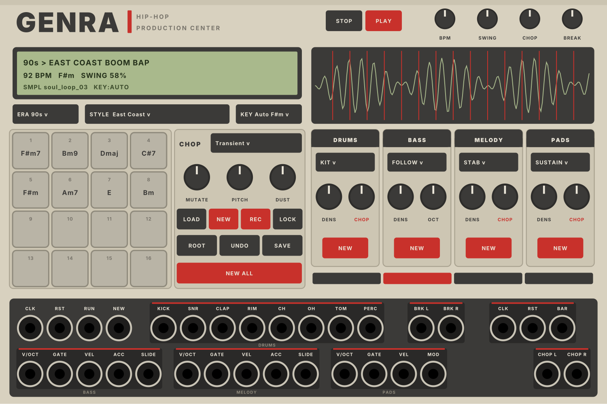

# GENRA HIP-HOP

Ein Hip-Hop-Beat-Generator im Look einer alten Production Center (beiges Gehäuse, graue Pads, Akai-Rot, grünes LCD).
Eigenes Plugin (**GENRA HipHop**, Slug `GenraHipHop`) unter der Marke **Genra**, liegt im Repo von GENRA Test im
Unterordner `genra-hiphop/`. Stand 2.0.1: Hauptordner fürs Laden, Drag & Drop, Lade-Schritte im Display und in `log.txt`.

## Installieren

Unter **Actions** den letzten erfolgreichen Lauf öffnen, Artefakt **genra-hiphop-windows** herunterladen (Mac:
**genra-hiphop-mac-…**, nur über Actions › Run workflow), die `.vcvplugin`-Datei in den Plugin-Ordner im
Rack-Benutzerordner legen (Rack › Help › Open user folder) und Rack neu starten.

## Bedienung

**Kopf:** PLAY startet und stoppt (ohne Kabel im RUN-Eingang). **BPM**, **SWING** (50 % gerade bis 75 %), **CHOP**
(Lautstärke der Chops) und **BREAK** (Lautstärke des Breaks).

**Display:** Jahrzehnt und Stil, Tempo, Tonart (ein `*` heisst: von Hand gesetzt), Swing, Takt; darunter das Sample
(Name, Anzahl Chops, ob die Tonart aus dem Sample kommt) oder der Stand der Analyse.

**ERA / STYLE / KEY:** anklicken = Liste, Mausrad = blättern. 29 Stile nach Jahrzehnt:
- **80s:** Electro Rap, Old School Boom Bap, Golden Age, Miami Bass, New Jack Swing
- **90s:** East Coast Boom Bap, Jazz Rap, Dark NY, G-Funk, West Coast Funk, Memphis, Dirty South
- **2000s:** Soul Chop, Dilla Wonky, Neptunes Timbaland, Crunk, Abstract, Snap
- **2010s:** Trap, Chicago Drill, UK Drill, Cloud Rap, Lo-Fi Hip-Hop, Ratchet, Grimy Revival
- **2020s:** Drumless, Rage, Plugg Pluggnb, Drift Phonk

Ein neuer Stil setzt BPM und Swing auf seine Werte und würfelt alles neu (mit UNDO zurück). **KEY Auto** nimmt die
Tonart aus dem Sample; eine Tonart von Hand würfelt Akkorde, Bass, Melodie und Pads neu.

**Pads (1–16):** jedes Pad ist ein Chop des Samples, mit dem erkannten Akkord (rot = von Hand gesetzt, HIT = ohne
Tonhöhe). **Klick** spielt das Pad. **Rechtsklick:** Lock (bleibt bei NEW und MUTATE stehen), Reverse, Pitch
(−12 bis +12) und Akkord (wie erkannt, keiner, oder von Hand). Unten auf dem Pad: L = Lock, R = Reverse, Pitch.
Über MIDI spielbar (Rechtsklick › MIDI input; C1 = Pad 1, mit Anschlagstärke).

**CHOP:**
- **MODE:** Transient (an den Anschlägen geschnitten), Equal 16, Equal 8. Ein Wechsel schneidet neu.
- **MUTATE:** wie viel der Chop-Spur sich alle vier Takte verändert (0 = steht).
- **PITCH:** alle Chops zusammen in Halbtönen. **DUST:** Vinyl, 12 Bit, dunkler.
- **LOAD:** WAV laden (Windows-Fenster, öffnet im Hauptordner: Rechtsklick › Sample root folder). Oder die WAV-Datei
  aufs Modul ziehen. Die Analyse läuft im Hintergrund: Chops, Akkord pro Chop, Tonart. Ohne Sample zeigt das Display
  den letzten Schritt (gelesen, analysiert, übergeben, in Gebrauch) oder den Fehler; dasselbe steht in Racks `log.txt`.
- **NEW:** neue Chop-Spur (mit den Akkorden, dem Bass und den Pads, die daran hängen).
- **REC:** was du auf den Pads spielst (Maus oder MIDI), landet auf dem nächsten Schritt in der Chop-Spur.
- **LOCK:** sperrt die Akkorde der vier Takte (NEW würfelt alles andere).
- **ROOT:** gedrückt halten = Grundton der Tonart zum Vergleichen (über den Chop-Ausgang).
- **UNDO:** bis zu acht Schritte zurück (vor jedem NEW, Stil- und Sample-Wechsel).
- **SAVE:** speichert die Chops als WAV-Dateien in einen Ordner (ohne Dateifenster; Standard
  `Dokumente/Chops from Genra/<Datum>_<Sample>/`). Rechtsklick: mit Pitch und Reverse der Pads oder roh (Standard).
- **NEW ALL:** alles neu (auch über den NEW-Eingang).

**Spuren:** je ein Feld für die Spielart, **DENS** (Dichte) und **NEW**.
- **DRUMS:** KIT (nur Trigger), BREAK (nur der Break), BOTH. **CHOP** = MIDI-Chop (Beats wiederholen, stottern,
  auslassen, umdrehen). Einen Break lädst du per Rechtsklick › Load break: die Hits werden nach Helligkeit auf Kick,
  Snare, Hats … verteilt und von den Drum-Hits gespielt (Ausgang BRK L/R).
- **BASS:** FOLLOW (Stil, folgt den Akkorden der Chops), ROOT+5, WALK, 808. **OCT** statt CHOP (kein MIDI-Chop).
- **MELODY:** STAB, LEAD, ARP, RIFF; **CHOP** = MIDI-Chop. Wo ein Chop einsetzt, tritt die Melodie zurück.
- **PADS:** SUSTAIN, STAB, SWELL (MOD-Ausgang steigt an); **CHOP** = MIDI-Chop.

**Buchsen:** CLK (16tel; 24 / 48 PPQN im Menü), RST, RUN, NEW. Drums: 8 Trigger (Spannung = Velocity) in GENRAs
Reihenfolge; Break L/R; CLK, RST, BAR (Trigger auf jeder Eins). Bass und Melodie: V/OCT, GATE, VEL, ACC, SLIDE.
Pads: V/OCT und GATE poly 4, VEL, MOD. Chop L/R.

**Rechtsklick:** Sample und Break laden, Break löschen, Chop-Ordner, **Export MIDI** (vier Takte, fünf Spuren: Drums
auf Kanal 10 mit GM-Noten, Bass, Melodie, Pads, Chop mit Pad 1 = C1, Pitch als Pitch-Bend ±12, Reverse als CC 20;
ohne Dateifenster in den MIDI-Ordner aller GENRA-Module), MIDI-Eingang, Clock-Auflösung.

## Noch nicht drin (Merkliste)

- **ABLAUF**-Verbindung (Patterns speichern, Hip-Hop-Abschnitte INTRO, VERSE, HOOK, BRIDGE, BREAK, OUTRO,
  MAKE SONG). Braucht eine Änderung an ABLAUF im GENRA-Repo.
- **Follow GENRA** für FUNKE, GRUND, SCHMELZ, DRUM-X ohne Kabel (die Instrumente kennen bisher nur GENRA; braucht eine
  Änderung an `Follow.cpp` im GENRA-Repo). Bis dahin per Kabel.
- Der PITCH-Regler verschiebt die Chops, aber noch nicht die erkannten Akkorde für Bass und Pads.

## Technik

- `src/hh/Core.*`: der Generator (vier Takte à 16 Schritte, fünf Spuren; DENS und MIDI-Chop rechnen live aus der
  Basis), `src/hh/Styles.cpp`: die 29 Stile, `src/hh/Chop.*`: WAV lesen/schreiben, Schnitt (Spectral Flux),
  12-Ton-Fingerabdruck pro Chop, Akkorde (Vorlagen-Vergleich), Tonart (Krumhansl-Profile). Ohne Rack testbar:
  `test/hh_test.cpp` (läuft im Build mit).
- `src/HipHop.cpp`: Modul und Panel-Teile, `src/Export.*`: MIDI-Datei und Ordner.
- `tools/hiphop_panel.py` schreibt `res/HipHop.svg`, die Knöpfe und `src/HipHopLayout.hpp`; prüft, dass sich keine
  Schrift überlappt. Vorschau: `python3 tools/hiphop_panel.py --preview docs/hiphop.png`.
